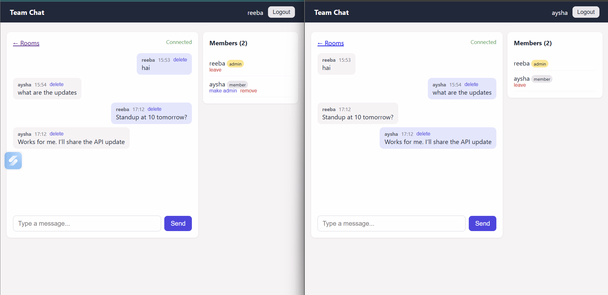
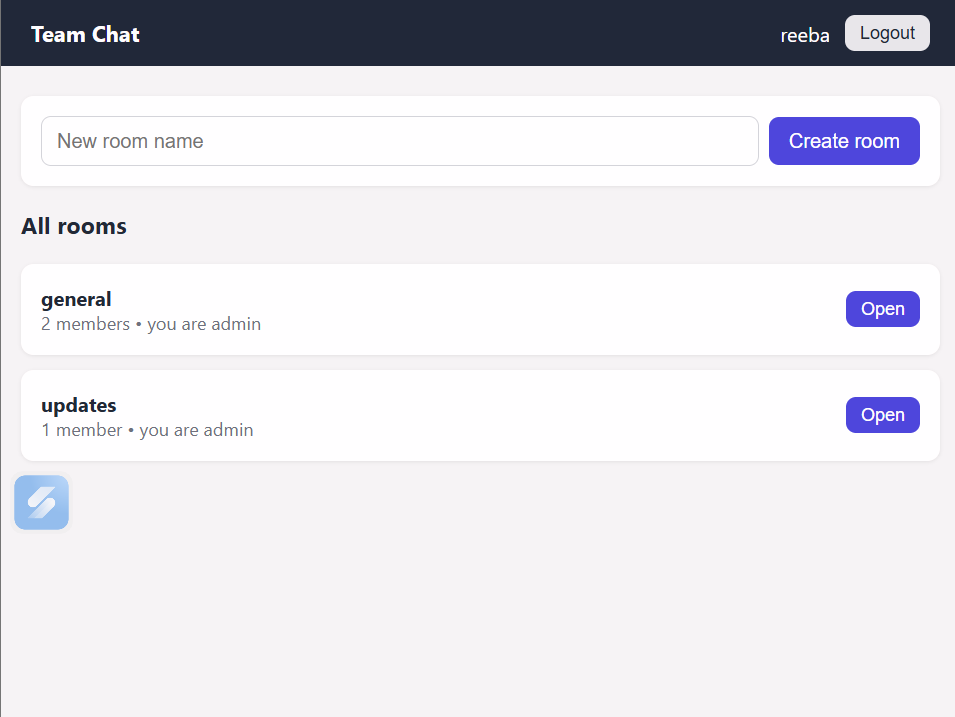
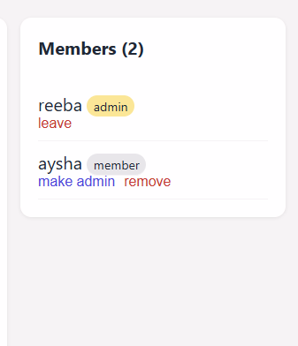

# Real-Time Team Chat

A full-stack real-time chat application where messages appear instantly for everyone in a room, with no page refresh. Built with **Django Channels (WebSockets)**, **React**, **Redis** and **PostgreSQL**, with **JWT authentication**, **role-based rooms** (admin / member) and a one-command **Docker Compose** setup.

## Screenshots

**Live chat between two users (normal window + incognito window)**



**Rooms list**



**Member management as a room admin**



## Features

- **Real-time messaging** over WebSockets, delivered to every member of a room instantly
- **JWT authentication** for both the REST API and the WebSocket connection, with automatic token refresh
- **Rooms with roles:** the creator becomes the admin; other users join as members
- **Admin controls:** promote or demote members, remove members, and delete any message
- **Member permissions:** members can post and delete only their own messages, and anyone can leave a room
- **Message history** loaded from the database when you open a room
- **Auto-reconnect:** the chat reconnects by itself if the connection drops, with a live connection status indicator
- **Automated tests** covering API permissions and WebSocket message broadcasting
- **Fully containerized** with Docker Compose (Django, React, PostgreSQL, Redis)

## Tech Stack

| Layer | Technology |
|---|---|
| Backend | Python, Django, Django REST Framework, Django Channels, Daphne (ASGI) |
| Real-time | WebSockets, Redis (channel layer) |
| Auth | JWT (`djangorestframework-simplejwt`) |
| Database | PostgreSQL (SQLite fallback for quick local runs) |
| Frontend | React 18, Vite, React Router, Axios |
| DevOps | Docker, Docker Compose |

## How It Works

```
  React (browser)
     |   REST (login, rooms, history, roles)        WebSocket (live messages)
     v                                                      v
  Django REST Framework  ------------------>  Channels consumer (ChatConsumer)
     |                                                      |
     |  save / read                                         |  broadcast to room group
     v                                                      v
  PostgreSQL                                            Redis channel layer
                                                            |
                                                            v
                                              every connected client in the room
```

1. A user logs in through the REST API and receives a JWT access and refresh token.
2. The React app opens `ws://.../ws/chat/<room_id>/?token=<access token>`.
3. A custom middleware validates the JWT, and the consumer checks that the user is a member of the room before accepting the connection.
4. When a user sends a message, the consumer saves it to PostgreSQL and broadcasts it through Redis to every client connected to that room.
5. Deleting a message through the REST API also broadcasts a "deleted" event, so it disappears for everyone immediately.

## Quick Start (Docker)

You need [Docker Desktop](https://www.docker.com/products/docker-desktop/) installed and running.

```bash
git clone https://github.com/reebarach-afk/realtime-team-chat.git
cd realtime-team-chat
```

Create the environment file by copying the example:

```bash
# macOS / Linux
cp .env.example .env

# Windows (PowerShell)
copy .env.example .env
```

Then start everything:

```bash
docker compose up --build
```

Open **http://localhost:5173**, register two users (use a normal window and an incognito window), create a room, join it from the second user, and start chatting.

Optional: create an admin user for the Django admin panel at `http://localhost:8000/admin`:

```bash
docker compose exec backend python manage.py createsuperuser
```

Stop the app with `Ctrl+C`, then `docker compose down`. Your data is kept in a Docker volume. Use `docker compose down -v` to wipe it.

## Running the Tests

```bash
docker compose exec -e REDIS_HOST= backend python manage.py test
```

The tests cover registration and login, room creation (the creator becomes admin), blocking non-members from reading messages, role changes (admins only), protection of the last admin, message deletion rules, WebSocket broadcast and persistence, and rejection of missing, invalid or non-member WebSocket connections.

## API Overview

| Method | Endpoint | Description |
|---|---|---|
| POST | `/api/auth/register/` | Create an account |
| POST | `/api/auth/login/` | Get access and refresh tokens |
| POST | `/api/auth/refresh/` | Refresh the access token |
| GET | `/api/auth/me/` | Current user |
| GET / POST | `/api/rooms/` | List rooms / create a room (creator becomes admin) |
| POST | `/api/rooms/<id>/join/` | Join a room as a member |
| GET | `/api/rooms/<id>/messages/` | Last 50 messages (members only) |
| GET | `/api/rooms/<id>/members/` | List members (members only) |
| PATCH | `/api/rooms/<id>/members/<user_id>/` | Change a member's role (admin only) |
| DELETE | `/api/rooms/<id>/members/<user_id>/` | Remove a member (admin) or leave the room (self) |
| DELETE | `/api/messages/<id>/` | Delete a message (own message, or any as admin) |

### WebSocket

Connect to `ws://localhost:8000/ws/chat/<room_id>/?token=<access_token>`.

- **Send:** `{"message": "hello"}`
- **Receive a message:** `{"type": "message", "id": 12, "user_id": 1, "username": "reeba", "content": "hello", "created_at": "..."}`
- **Receive a deletion:** `{"type": "deleted", "id": 12}`

Connections are rejected if the token is missing or invalid, or if the user is not a member of the room.

## Project Structure

```
realtime-team-chat/
|-- docker-compose.yml
|-- .env.example
|-- backend/
|   |-- Dockerfile
|   |-- config/            # settings, ASGI routing
|   |-- accounts/          # register, login, current user
|   `-- chat/              # models, REST views, WebSocket consumer,
|                          # JWT middleware, tests
`-- frontend/
    |-- Dockerfile
    `-- src/
        |-- api.js         # Axios client with automatic token refresh
        |-- AuthContext.jsx
        `-- pages/         # Login, Register, Rooms, ChatRoom
```

## Design Decisions

- **JWT in the WebSocket URL:** browsers cannot set an `Authorization` header on a WebSocket, so the token is sent as a query parameter and validated by custom Channels middleware.
- **Permissions enforced on the server:** room membership is checked when a WebSocket connects, and roles are checked on every REST action, so the UI controls are only a convenience.
- **Redis channel layer:** it lets messages reach clients connected to different server processes, so the app can scale beyond a single process.
- **Last-admin protection:** a room can never be left without an admin.

## Possible Improvements

- Typing indicators and read receipts
- Private (direct) messages
- Nginx production setup and CI pipeline with GitHub Actions
- Live deployment

## Author

**Reeba Rachel Jogi**: [GitHub](https://github.com/reebarach-afk)
